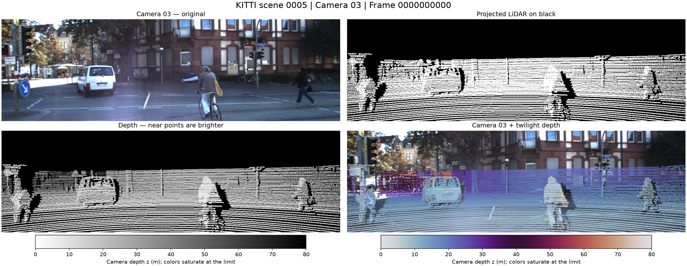

# KITTI LiDAR projection — camera 03

This assignment projects a Velodyne point cloud from **2011_09_26, drive 0005** into the **right color camera, `image_03`**. The implementation follows the six assignment steps in one Python script, with separate functions for calibration, geometry, and visualization.



## Run

Use Python 3.10 or newer. From the project directory:

```bash
python3 -m venv .venv
.venv/bin/python -m pip install -r requirements.txt
.venv/bin/python project_points.py
```

The default is frame `0000000000`. To process another synchronized frame:

```bash
.venv/bin/python project_points.py --frame 75
```

Optional arguments are `--scene-dir`, `--calib-dir`, `--output-dir`, `--max-depth` (default: 80 meters), and `--radius` (default: 2 pixels). Run `--help` for details. The script saves images without requiring a desktop or GUI.

## 1. Scene and calibration

The scene and calibration are already downloaded and extracted in this workspace. There are **154 matching camera-03 images and LiDAR scans**, numbered `0000000000` through `0000000153`.

To obtain a fresh copy, use the [official KITTI raw-data page](https://www.cvlibs.net/datasets/kitti/raw_data.php). Select **2011_09_26_drive_0005**, download the **synced+rectified** scene and **2011_09_26 calibration**, and place the ZIP files in `data/archives/`. The download page currently requires a KITTI login. The synced images have already been undistorted and rectified; use their corresponding calibration rather than raw-image distortion parameters.

Extract the archives into the layout used by the defaults:

```bash
python3 -m zipfile -e data/archives/2011_09_26_drive_0005_sync.zip data/raw-data/2011_09_26_drive_0005_sync
python3 -m zipfile -e data/archives/2011_09_26_calib.zip data/raw-data/2011_09_26_calib
```

```text
data/
├── archives/
│   ├── 2011_09_26_drive_0005_sync.zip
│   └── 2011_09_26_calib.zip
└── raw-data/
    ├── 2011_09_26_calib/2011_09_26/
    │   ├── calib_cam_to_cam.txt
    │   └── calib_velo_to_cam.txt
    └── 2011_09_26_drive_0005_sync/2011_09_26/2011_09_26_drive_0005_sync/
        ├── image_03/data/0000000000.png
        └── velodyne_points/data/0000000000.bin
```

Pair the image and scan by their frame number. Their timestamps need not be identical: for frame 0, the camera timestamp is approximately 10 ms after the LiDAR timestamp. KITTI's processed sequence supplies the frame correspondence; this solution does not interpolate poses or compensate individual laser returns for motion.

## 2. Read the calibration files

`read_calibration()` parses the numeric fields in row-major order and skips `calib_time`. `load_calibration()` extracts:

| File | Fields | Meaning | Shape |
| --- | --- | --- | --- |
| `calib_velo_to_cam.txt` | `R`, `T` | Velodyne → unrectified reference camera 00 | 3×3, 3 |
| `calib_cam_to_cam.txt` | `R_03`, `T_03` | Unrectified camera 00 → unrectified camera 03 | 3×3, 3 |
| `calib_cam_to_cam.txt` | `R_rect_03` | Rectification rotation for camera 03 | 3×3 |
| `calib_cam_to_cam.txt` | `P_rect_03` | Projection from rectified reference camera 00 into image 03 | 3×4 |
| `calib_cam_to_cam.txt` | `R_rect_00` | Reference-camera rectification, used for verification | 3×3 |
| `calib_cam_to_cam.txt` | `S_rect_03` | Rectified image width and height | 2 |

The actual projection matrix is:

```text
P_rect_03 = [721.5377    0.0000  609.5593  -339.524200]
            [  0.0000  721.5377 172.8540     2.199936]
            [  0.0000    0.0000   1.0000     0.002730]
```

All extracted matrices and constructed transforms are saved at full input precision in `summary.json`.

## 3. Construct the rigid transforms

Use column vectors and homogeneous coordinates. For a rotation `R` and translation `t`, `rigid_transform()` builds:

```text
T = [ R  t ]       X_destination = T @ X_source
    [ 0  1 ]
```

`T_cam0_from_velo` contains the Velodyne-to-reference registration. `T_cam3_from_cam0` contains `R_03` and `T_03`. Extend `R_rect_03` to 4×4 with zero translation.

The combined transform is:

```text
T_rect_cam3_from_velo = R_rect_03_h @ T_cam3_from_cam0 @ T_cam0_from_velo
```

The rightmost operation acts first. Velodyne axes are forward/left/up; camera axes are right/down/forward. Depth is the **z coordinate in rectified camera 03**, in meters, rather than Euclidean distance from the laser.

## 4. Transform and project the points

A `.bin` record contains four little-endian float32 values: `[x, y, z, reflectance]`. Reflectance is excluded from the geometry; each point receives a homogeneous fourth coordinate of **1**.

`project_points()` performs:

```text
X_cam0   = T_cam0_from_velo @ [x, y, z, 1]
X_cam3   = T_cam3_from_cam0 @ X_cam0
X_rect3  = R_rect_03_h @ X_cam3
q        = K_rect3 @ X_rect3[:3]       where K_rect3 = P_rect_03[:, :3]
u, v     = q[0] / q[2], q[1] / q[2]
```

**Why use the intrinsic block here?** The fourth column of `P_rect_03` already encodes camera 03's displacement from the rectified reference camera. After explicitly moving points into camera 03, applying that displacement again would shift the projection a second time.

For an independent check, `reference_projection_error()` also computes KITTI's reference-camera formula:

```text
q_reference = P_rect_03 @ R_rect_00_h @ T_cam0_from_velo @ [x, y, z, 1]
```

This formula uses the **entire** 3×4 matrix, including its nonzero vertical and depth translation terms. These two routes are nearly equivalent for the supplied calibration. Their maximum Euclidean pixel difference on frame 0 is **0.056486 px**. The supplied raw-camera extrinsics and rectified projection have a small residual translation difference, so exact numerical equality is not expected. The implementation renders the explicit camera-03 route to demonstrate the requested transformations. See the [KITTI dataset paper, Section IV, equations 4–7](https://www.cvlibs.net/publications/Geiger2013IJRR.pdf) for the reference convention.

Before rasterization, discard nonfinite points, nonpositive camera depth, and coordinates outside `0 ≤ u < width`, `0 ≤ v < height`. Check floating-point bounds before converting coordinates to integers. Use `floor(u), floor(v)` as the pixel index and keep the **nearest depth** if several points fall into the same pixel.

## 5–6. Visualize and save

Results are written to `results/frame_<10-digit-index>/`:

| Output | Contents |
| --- | --- |
| `points_on_black.png` | White projected points on a black image |
| `depth_grayscale.png` | Near points are bright; far points are dark; background is black |
| `overlay_twilight.png` | Depth-colored points on the matching camera-03 image |
| `overview.png` | Four panels, titles, and depth color scales |
| `depth_meters.npy` | Float32 sparse depth map in meters; zero means no measurement |
| `summary.json` | Counts, depth range, reference error, and calibration matrices |

For both depth displays, normalize `z / max_depth` and clip to `[0, 1]`. This changes the color scale without removing distant geometry. The overlay uses Matplotlib's **256-entry `twilight` colormap**, with the RGB output converted to BGR for OpenCV. Draw filled circles with `cv2.circle(..., thickness=-1)`, from far to near so nearby points remain visible where circles overlap.

The circle radius improves display visibility; it does not fill gaps in the saved metric depth map. The map remains sparse. Keeping the nearest measurement per pixel resolves direct collisions, but it does not recover surfaces hidden from the LiDAR or compensate for camera/LiDAR viewpoint differences.

Measured frame-0 results:

| Measurement | Value |
| --- | --- |
| Camera image | 1242 × 375 pixels |
| Input LiDAR points | 123,397 |
| Visible points, explicit camera-03 route | 20,501 |
| Occupied depth pixels | 20,365 |
| Visible depth range | 4.934–68.262 m |
| Maximum difference from reference projection | 0.056486 px |

The reference formula places 20,500 points inside the image; one point near an image boundary changes visibility between the two calibration routes.

The data archives, extracted dataset, virtual environment, caches, and generated `.npy` depth arrays are excluded from Git. The sample PNGs and summary can be kept with the assignment.
